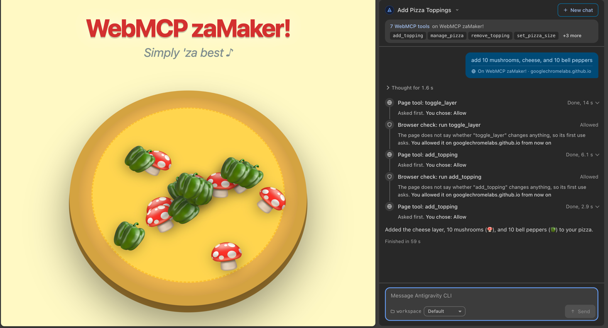

# Browser Harness

A Chrome side panel for chatting with the coding agent already on your computer — Claude Code, Codex, or Antigravity CLI — and letting it co-browse with you.



*Antigravity CLI next to the WebMCP zaMaker demo, adding toppings through the page's own WebMCP tools.*

> [!WARNING]
> **Experimental prototype — for demonstration and educational purposes only.**
>
> Browser Harness connects web pages to a local coding agent that has shell and filesystem access on your computer under your own login. Text on a web page can attempt prompt injection, and the extension requests broad browser permissions (`<all_urls>` and `chrome.debugger`). Its guardrails reduce risk; they do not eliminate it.
>
> Use a **separate Chrome profile**, pages you trust, and an empty working folder with nothing sensitive in it. Use at your own risk.

Available under the [MIT License](LICENSE).

## The experiment

**The question:** what if you could bring *your* agent into the browser? Not the agent built into the browser, and not the one a website embeds, but the one you already use every day: the one that knows your instructions, your projects and your files, that you already signed in to and already pay for.

**The hypothesis:** nothing new has to be invented for that, because both protocols already exist.

- **On the agent side, [ACP](https://agentclientprotocol.com).** It is what editors use to talk to coding agents. A browser side panel can drive an agent the same way an IDE does, so each chat is simply a session in that agent.
- **On the website side, [WebMCP](https://github.com/webmachinelearning/webmcp), mirrored as MCP.** The extension reads the tools the active tab registered and hands them to the agent through an ordinary MCP server called `browser`. A page's `add_todo` becomes `webmcp_add_todo`, and the call runs inside the page.

To the agent, the browser is then just one more MCP server next to everything else it has.

**What it showed:**

- **The agent's context comes along for free.** No API keys, the login from your terminal, your files and shell, and the agent's own instructions, skills and other MCP servers. "Fill this form from the CSV in my project folder" is two ordinary steps.
- **Sessions carry over.** A task started in the terminal can be picked up in the side panel, with its history and its project folder, when the next step is on a website.
- **One set of WebMCP tools serves every agent.** A site ships its tools once; Claude Code, Codex and Antigravity CLI all use them, and fall back to reading and clicking where a page has none.
- **An agent that lives outside the browser can still co-browse.** The harness is a process on your machine; its work happens in the tab you are looking at, while you watch and can stop it.

**What it does not solve:**

- **The page is sandboxed; the agent is not.** A WebMCP tool runs with the access its site already has. The agent reading that page has a shell. Prompt injection is the open problem here, and the approvals and the untrusted-content fence below are mitigations, not a boundary.
- **Two confirmations for one action.** The agent knows *why* it acts and the browser knows *what* the page will do, and neither ACP nor MCP can merge the two into one question, so a single WebMCP call can ask twice.
- **Starting in an empty folder is a polite default, not a wall.** Running browser chats in a real sandbox would make the two sides match.

This is a prototype for people who already use a coding agent daily. It is not a product, and it is not hardened.

## What it does

- **Uses your existing agent and login.** The extension holds no API keys and calls no model APIs directly. It speaks the [Agent Client Protocol](https://agentclientprotocol.com) (ACP) to the agent installed on your machine through a small local Node bridge.
- **One chat = one ACP session.** Start new sessions from the side panel or bring in existing sessions you started in the terminal.
- **Gives the agent a `browser` MCP server:**
  - **WebMCP tools first:** exposes the active tab's `document.modelContext` tools so the agent uses the page's own API when available.
  - **Generic browser actions:** `snapshot` (accessibility tree), `click`, `type`, `press_key`, `scroll`, `navigate`, and `screenshot` for pages without WebMCP — or turn on **Page tools only** in Settings to disable generic DOM actions completely.
- **Two layers of approval:** your agent keeps its own permission prompts, and the extension adds a browser check before consequential WebMCP calls, form submissions, risky buttons, password fields, cross-origin navigation, or reaching into a tab of another site.

Architecture details: [docs/ARCHITECTURE.md](docs/ARCHITECTURE.md).

## Setup

### Prerequisites

- **Node.js 20.19+**
- **Chrome 140+** on macOS or Linux (Windows is not supported by the host installer). To expose native `document.modelContext` on WebMCP pages, start Chrome with `--enable-features=WebMCP` or enable the WebMCP flag in `chrome://flags`.
- **At least one supported agent** installed and signed in once in its own terminal:

| Agent | Install | Sign in | ACP launch |
| --- | --- | --- | --- |
| Claude Code | `npm i -g @anthropic-ai/claude-code` | `claude`, then `/login` | `claude-agent-acp` (or `npx` fallback) |
| Codex | `npm i -g @openai/codex` | `codex login` | `codex-acp` (or `npx` fallback) |
| Antigravity CLI | `curl -fsSL https://antigravity.google/cli/install.sh \| bash` | `agy` | `agy acp` |

*(Optional: `npm i -g @agentclientprotocol/claude-agent-acp @agentclientprotocol/codex-acp` skips the first-run `npx` download for Claude Code and Codex.)*

### Install

1. **Build the extension and register the native messaging bridge:**

   ```sh
   npm install
   npm run install-host
   ```

   This builds `dist/`, writes `~/.browser-harness/browser-harness-host`, and registers `com.kulikowski.browser_harness` for Chrome/Chromium. *(To remove it later: `npm run uninstall-host`. If you launch Chrome with a custom `--user-data-dir`, run `node dist/bridge/install.js --user-data-dir <dir>`.)*

2. **Load the unpacked extension:** open `chrome://extensions`, enable **Developer mode**, click **Load unpacked**, and select `dist/extension`.

3. **Open the side panel:** click the Browser Harness toolbar icon (or press `Cmd+Shift+Y` / `Ctrl+Shift+Y`), pick an installed agent, and start chatting. New chats run in `~/.browser-harness/workspace` by default and start in the agent's ask-first mode when available; both can be changed in the panel.

## Development

```sh
npm run build      # bundle dist/extension and dist/bridge
npm run typecheck  # TypeScript check (bridge + extension)
npm run lint       # ESLint (--max-warnings 0)
npm run format     # Prettier (format:check only checks)
npm run test:unit  # Vitest unit + native-messaging bridge integration tests
npm run test:e2e   # Playwright e2e tests in headless Chrome (override binary with CHROME_PATH)
npm run check      # typecheck + lint + format:check + unit + e2e
```
