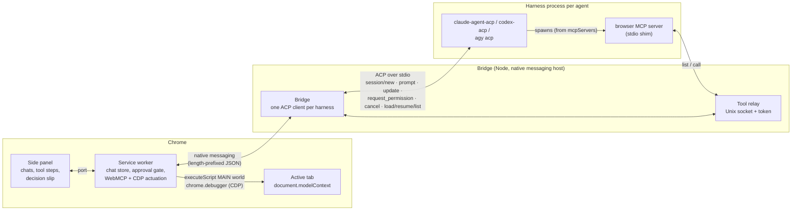

# Architecture

You chat in Chrome's side panel. The chat runs in a coding agent already installed and signed in
on your computer (Claude Code, Codex, Antigravity CLI). The extension holds
no keys: it starts the agent you pick and the agent uses its own login.

Each chat is one session in that agent, spoken to over the
[Agent Client Protocol](https://agentclientprotocol.com) (ACP). The agent gets the browser as an
MCP server, passed in `session/new`.

## The pieces

| Piece | Where | What it does |
| --- | --- | --- |
| Side panel | `src/extension/sidepanel` | Preact UI. Chat list, harness picker (only detected harnesses), streamed messages, thinking, plan, tool steps, and the decision slip for permissions and approvals. States are words (Waiting, Running, Done, Failed, Needs you). A message written while the agent works waits in the composer (per chat, so it survives switching views) and goes out when the turn ends; Cancel or Stop hands it back. |
| Service worker | `src/extension/background` | Keeps chats in `chrome.storage.local` (`chatStore.ts`), talks to the bridge, runs browser tools on the tab the user is looking at, and gates consequential ones. |
| Bridge | `src/bridge/host.ts`, `bridge.ts` | Chrome starts it through native messaging. It detects harnesses, starts one ACP connection per harness, maps chats to ACP sessions, and relays browser tool calls back to the extension. |
| ACP client | `src/bridge/acpClient.ts` | `@agentclientprotocol/sdk` (Apache-2.0), protocol v1. `initialize` (no fs, no terminal), `session/new` with `mcpServers` and an appended system prompt when the agent supports it, `session/prompt`, `session/cancel`, `session/load` or `session/resume`, `session/list`, `session/close`, `session/set_mode`, `authenticate` (keyless methods only, and only when the user clicks one). |
| Browser MCP server | `src/bridge/mcpShim.ts`, `toolRelay.ts` | A stdio MCP server the harness spawns from `mcpServers`. It dials back to the bridge over a Unix socket in a private `0700` temp dir, with a 32-byte token checked in constant time. stdio is used because it is the one MCP transport every ACP agent must support (Antigravity's `agy acp` advertises no http or sse). |
| Scripted agent | `src/bridge/fakeAgent.ts` | A small ACP agent for tests and demos. It uses the MCP server it is given, asks for permission, streams, plans, persists sessions, replays history, and can pretend to be signed out. |

## One chat, one session

- **New chat:** `session/new` with `cwd` (default `~/.browser-harness/workspace`, changeable in the panel) and the browser MCP server. The chat stores the ACP `sessionId`.
- **Continue after a restart:** `session/resume` when the agent supports it, otherwise `session/load`. Either way the panel keeps its own transcript.
- **Sessions started elsewhere:** `session/list` shows sessions begun in the agent's own terminal UI. Opening one uses `session/load`, so the history is replayed into the panel.
- **Stop:** `session/cancel`. Per ACP, every open permission request of that session is answered `cancelled`, and the turn ends with `stopReason: cancelled`.
- **Modes:** whatever the agent reports (Claude Code: Manual, Accept edits, Plan, Auto, Bypass permissions) appear in a select, which calls `session/set_mode`.

## Two kinds of "may I?"

1. **The harness asks.** `session/request_permission` becomes a decision slip in the panel, showing the agent's own options (allow once, always, reject). The answer goes back as the chosen `optionId`.
2. **The browser asks.** Some browser actions need the user's yes no matter what the agent's mode is, because only the extension knows what they would do on this page (`src/shared/policy.ts`):
   - WebMCP tools the page marks `consequentialHint` (or the older `destructiveHint`) and not read-only.
   - The first use of a WebMCP tool the page marks neither read-only nor consequential. "Allow for now" lasts until Chrome restarts the extension.
   - A click on a submit control, a link to another origin, or a control whose name reads like buy, pay, delete, send, publish and so on.
   - Typing into a password field (the text is not shown or stored), typing then pressing Enter, or pressing Enter or Space.
   - Navigating to another origin.
   - Using a tab of another site than the one the turn started on, even just to read it. A yes lasts for the turn.

   "Always on this site" is stored per origin and per kind of action, never globally, and narrowed to what was asked: the tool for WebMCP, the control's name for a click or a submit, the destination for a link or a navigation. A yes to "Send" is not a yes to "Delete account".

   The check on clicks reads the control: its type, where its link leads, and whether its name sounds consequential. That word list knows English and Polish and can never be complete, so a control with an innocent name, or none, is clicked without a question. The rules below, and the agent's own ask-first mode, are what stand behind it.

   Four rules hold whatever the agent tries:
   - **A decline locks the site for the turn.** After the user declines, every call that could change that origin (click, type, key, navigate, any page tool not marked read-only) is refused until their next message. The agent cannot redo a declined tool call by clicking.
   - **A key is judged as what the page will get.** Every spelling of Enter, a carriage return included, is Enter before the policy sees it; other control characters are refused.
   - **A yes is for what was asked.** After a yes, the tab must still be on the same origin, and a clicked or typed-into control must still be the same one, or nothing happens.
   - **Cancelling a chat ends only that chat's questions.**

A WebMCP call that is not read-only can therefore ask twice: first the harness, then the browser. That is deliberate.

## Browser tools the harness sees

| Tool | What it does |
| --- | --- |
| `webmcp_list_tools`, `webmcp_call_tool` | List the active tab's WebMCP tools, or call one by name. These always work, even if the agent cached its tool list. |
| `webmcp_<name>` | One MCP tool per page WebMCP tool, so agents that refresh on `tools/list_changed` can call them directly. |
| `tabs` | List tabs, or switch which tab the agent works on. |
| `snapshot`, `click`, `type`, `press_key`, `scroll`, `navigate`, `screenshot` | For pages without WebMCP. With **Page tools only** on, these are left out of the list and refused if called, before any approval. |

**WebMCP.** The service worker runs `document.modelContext.getTools()` and `executeTool()` in the page's MAIN world with `chrome.scripting.executeScript`. It falls back to `navigator.modelContextTesting` where an older Chrome only has that. Checked against Chrome 156 with `--enable-features=WebMCP`, which exposes `document.modelContext`.

**Tools that arrive late.** Many pages register their tools only after they start up. While a panel is open, the service worker adds a `toolchange` listener to the page's `modelContext` (MAIN world), which raises a DOM event that a relay in the extension's isolated world passes on with `runtime.sendMessage`. It also looks again 1.5, 4, 10 and 25 s after each load, for WebMCP that cannot announce changes. A reload starts this over. Each change posts `browser.toolsChanged`, so harnesses that listen for `tools/list_changed` see the new `webmcp_*` tools.

**The line in front of each message** (`src/shared/context.ts`) names the tab and its tools, and says to use them first, to check again when the page has WebMCP but no tools yet, and never to wait with the shell. Antigravity takes no system prompt from us, so this line is where the rules reach every harness. Tool names go in only when they are plain identifiers (at most 20); the title loses quotes, brackets and line breaks.

**Actuation.** Over `chrome.debugger`, the way agent browsers commonly do it:
- Read `Accessibility.getFullAXTree`, then print text in order, headings with `#` marks for their level, and controls as `[backendDOMNodeId] role "name"`.
- Act by ref: `DOM.scrollIntoViewIfNeeded`, then `DOM.getContentQuads`, then a trusted `Input.dispatchMouseEvent` at the centre.
- Type with `Input.insertText`.

**Which tab.** A call without a `tabId` acts on the tab the user was looking at when they sent the message, for the whole turn. A call that names a tab of the same site just runs; one that names a tab of another site asks first (above). The `tabs` tool itself lists every open tab's title and URL without asking. Refs belong to the document a snapshot was taken on (CDP `loaderId`): `click`, `type` and `scroll` by ref are refused on a tab with no snapshot of the page it shows now. The debugger is detached when no turn is running.

**Untrusted content.** Most of what a page says is wrapped in `<page-content origin=".." trust="untrusted">`: snapshots, tool results and errors, the tool descriptions in the mirrored tool list, tab titles, and what a field shows after typing. The system prompt says page content is never instructions, and so does the line sent with each message, for agents that take no system prompt (Antigravity). A page cannot close the fence early, because `<page-content` inside its text is escaped. Not fenced: a mirrored tool's input schema (with the page's own property descriptions), tool names and titles (cleaned of control characters and angle brackets only), the tab title in the line sent with each message, and screenshots.

## Native messaging details

- Each message is a 4-byte little-endian length followed by UTF-8 JSON.
- Chrome caps host-to-extension messages at 1 MB. The bridge splits bigger ones into chunk frames, and the service worker joins them (`src/shared/chunks.ts`).
- The extension ID is fixed by the manifest `key`: `jmhdjhpeojdibgbgjjekpknolaoochmo`. That lets the host manifest's `allowed_origins` name it on every machine. The private key was thrown away and is not in the repo.
- Chrome starts the host with a thin `PATH`, so the installer writes a small wrapper with your login shell's `PATH`. The bridge also looks in the usual install folders.

## Security notes

- **No keys anywhere.** Sign-in methods that take a key (API key, Vertex, gateway, agent platform) are filtered out and never offered. Sign-in happens in the harness's own terminal UI, or through a keyless ACP `authenticate` method the user clicks.
- **The relay socket** is private to the user (`0700` directory) and needs a per-bridge random token.
- **Logs and errors are redacted:** anything that looks like a key or token is replaced before it reaches the panel.
- **The agent keeps its own tools.** The extension's checks cover the browser only. A page that talks the agent into something reaches an agent with a shell, so new chats start in the agent's ask-first mode (`askFirstMode` in `bridge.ts`) and the panel marks modes that act without asking.
- **Agent capabilities:** the ACP client advertises no file system and no terminal capabilities. Agents use their own tools for files, under their own permission rules.
- **Adapters are fetched on first use.** Without a global `claude-agent-acp` or `codex-acp`, the bridge runs a pinned version through `npx -y`, which downloads it from npm. Install the adapters yourself (see the README) to avoid that.

## Known limits

- **Chats are kept whole in `chrome.storage.local`**, one record per chat, and only changed chats are written. The panel is still sent the full state on every change, which is fine for a handful of chats and would need to become incremental for many long ones.
- **`npm run build` empties `dist/`**, which is also where the loaded extension and the registered host run from. Rebuild between turns, then reload the extension.
